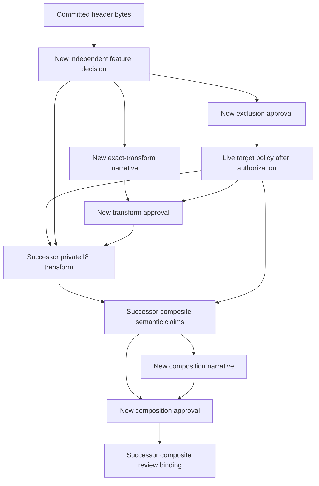

# Pending API18 parser-witness binding refresh

This is an author proposal for a new independent review. It installs no
authority, changes no accepted artifact and supplies no execution evidence.
The [machine-readable graph](api18-parser-status-binding-refresh.author-proposal.json)
binds the committed header delta from `f8d8f02`, the nine affected live artifact
identities and fifteen transitive binding edges. Future reviewer identities
and successor hashes remain unset.

The old `c_api/tests/load_dump_contract.h` hash is
`b5cdfdc3d447e74bfc3b40e9e5345b5941a5ca41783abead67950b537f8c2989`.
The committed parser checkpoint changes it to
`f8d056b921b31b72566978aed8a19226ce06029c81bd349d0c2051c5b92e2c0c`.
The existing feature review requires the old hash, so strict inventory and
source generation correctly reject the current source. This proposal does
not bypass that rejection.

All 28 original named witness bodies retain identical bytes. The dispatcher
adds exactly two calls to one new helper: contiguous and streamed parser
depth errors must return `LUA_ERRRUN` with exact `C stack overflow`, preserve
the incoming stack value and allow a successful retry on the same state.
Removing only the new helper and those two calls reconstructs the complete
old header hash. The JSON records both inserted spans and each original
function's old/current byte span and hash. These checks establish source
preservation; the parser commit also contains runtime changes, whose execution
evidence and acceptance remain separate.

The live dependency graph is:

The composite semantic hash excludes its `review` field. Its final approval
binding therefore does not form a hash cycle. Recompute the graph in dependency
order after actual new reviewer artifacts exist; copying old `accepted`
labels, reviewer identities or rationales would not establish a new review.

The proposed refresh preserves the original Lua source, the exact eighteen
removed bytes, its child ID and both required parent assertions. The private18
output stays `51389bf3404ab2f13ae88a8cc3f88e7188ac0639f77b7871f4c9baf1830492bc`;
the disjoint API composite stays
`c360ae605ad7d2e7935a38ad684a5bb0fd081e59d6d3cc397527864f75cc77d3`.
The original parent ledger records remain pending with empty evidence.

Preserve the dated author proposals, actual observation reports, historical
reviews, original source/API ledgers and both protected accepted scope
descriptors. A successor transform can keep the original author-proposal
identity as dated evidence while binding a new current-source decision.
The API941 equivalent, calls equivalent and memory verifier do not acquire
new approval through this parser-only graph. Any later Engine/Foreign pool
changes require a separate committed-source dependency audit, author proposal
and independent review.

After approval and authorized installation, future execution selections,
Aggregate selections, operation contracts and envelopes must bind the new
policy and selected manifest identities. Collect new raw observations from
the final committed runtime; do not rewrite old reports to new hashes. A fresh
instrumented `calls.lua` pair will use the approved Ada selector and original
native C source, with the explicit dump/return protocol and complete allocator
telemetry. That pair remains an observation until the required contract,
envelope and full context matrix have been reviewed and reconciled.
